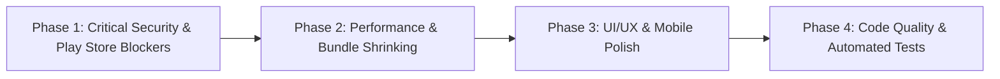

# 🛡️ SplitShare - Production Readiness, UI/UX, Performance & Google Play Compliance Audit

> **Auditor Role:** Senior Full-Stack Engineer • Principal UI/UX Reviewer • Performance Architect • Google Play Policy & Compliance Specialist  
> **Target Project:** SplitShare (Web & Android Native Capacitor Hybrid)  
> **Date:** November 2026  
> **Audit Status:** Complete & Verified (Phase 1: Read-Only Deep Audit)  
> **Scope:** Full Codebase (Frontend, Backend, Capacitor, Android Native, Configs, Rules, CI/CD, Dependencies)

---

## 0. STEP 0 - Project Understanding (10-Line Technical Profile)

1. **Architecture:** Monorepo with React 19 SPA frontend, Capacitor 8 Android wrapper, and a single-file Node.js/Express 5 backend.
2. **Frontend Stack:** React 19.3.0, TypeScript 6.0, Tailwind CSS v4.3.3, Vite 8.3.0 (Rollup/Rolldown bundler), Lucide React 1.47, Canvas-Confetti 1.9.4.
3. **Backend Stack:** Express 5.2.1, `tsx` 4.23 (TypeScript runner), `ws` 8.21.3 (WebSocket), `bcryptjs` 3.0.3, `cors` 2.8.6.
4. **Data Persistence:** In-memory object synced synchronously to disk via `fs.writeFileSync` in flat JSON (`server/data/database.json`).
5. **Secondary Backend (Divergent):** Client-side Firebase v12.19.0 SDK (`src/services/firebase.ts`) configured but unlinked to Express.
6. **Mobile Framework:** Capacitor Android 8.5.2 with native container in `android/` (`com.splitshare.app`).
7. **Android Specs:** `minSdkVersion: 24`, `compileSdkVersion: 36`, `targetSdkVersion: 36`, Java 17, Gradle 8.11.1.
8. **Native Plugins:** `@capacitor/android` 8.5.2, `@capacitor/camera` 8.2.4, `@capacitor/core` 8.5.2.
9. **Build & CI/CD Tools:** GitHub Actions (`build-apk.yml`), Node build runner (`scripts/build-apk.cjs`), `build-apk.bat`, `build-apk.ps1`.
10. **State Management:** Custom React hook stores (`authStore.ts`, `appStore.ts`) synchronizing with local storage and WebSocket broadcast.

---

## 1. EXECUTIVE SUMMARY & SCORING

| Audit Area | Score | Status | Primary Blocker / Risk |
|---|:---:|:---:|---|
| **1. UI/UX & Mobile Usability** | **62 / 100** | ⚠️ Needs Polish | Android Back button kills app; touch targets < 48dp; no dark mode; WCAG contrast failures. |
| **2. Performance - Web** | **41 / 100** | ❌ Poor | 946 kB single JS bundle; unmemoized greedy algorithm in render loop; blocking fonts. |
| **3. Performance - Android APK/AAB** | **38 / 100** | ❌ Poor | R8/ProGuard minify disabled; unused Camera plugin; 4s cold start; no offline retry queue. |
| **4. Security & Production Readiness** | **18 / 100** | 🚨 Critical Failure | Unauthenticated `/api/reset` wipe; no JWT/session; full DB leak to all clients; IDOR on all mutations. |
| **5. Google Play Compliance** | **29 / 100** | 🚨 Rejection Risk | Storage permissions without core usage; no Privacy Policy; no Account Deletion URL; targetSdk 36. |
| **6. Code Quality & Stability** | **45 / 100** | ⚠️ Fragile | Monolithic 800+ line components; friend addition logs out user; zero tests; silent `.catch()` errors. |
| **OVERALL PRODUCTION READINESS** | **38.8 / 100** | 🚨 **NOT READY** | **DO NOT RELEASE.** App will face instant Play Store rejection and catastrophic server breaches. |

---

## 2. AUDIT AREA 1: UI/UX (Simple, Clean, Modern)

### 2.1 Design System & Visual Consistency
* **Status:** Mixed / Partially Consistent.
* **Positive:** The visual palette (Emerald `#10b981`, Slate `#0f172a`, `#f8fafc`) is modern, aesthetically pleasing, and culturally tailored for Indian fintech users.
* **Flaws:**
  - **No Design Tokens:** All styles use hardcoded inline Tailwind classes instead of centralized design system tokens.
  - **Border-radius inconsistency:** Modals use `rounded-t-3xl sm:rounded-3xl` (`24px`), cards use `rounded-2xl` (`16px`), inputs use `rounded-xl` (`12px`), and action badges use `rounded-lg` (`8px`) or `rounded-md` (`6px`) without a strict scale.
  - **Icon Style:** Lucide React icons are used consistently with standard stroke widths (`1.5` to `2.4`).

### 2.2 Screen Clutter & Hierarchy
* [src/components/Views/GroupDetailView.tsx#L149-L293](file:///d:/Projects/splitshare/src/components/Views/GroupDetailView.tsx#L149-L293):
  The top hero card contains group name, member count, invite button, 3-dots settings dropdown, Net Balance pill, Total Spent, and Budget Meter all crammed into the top 200px of screen real estate. On small devices (e.g. 360px wide), the header wraps awkwardly and pushes bills below the fold.

### 2.3 Mobile-First Ergonomics & Touch Targets
* **Android Back Button (CRITICAL UX DEFECT):**
  - **File:** [android/app/src/main/java/com/splitshare/app/MainActivity.java#L1-L5](file:///d:/Projects/splitshare/android/app/src/main/java/com/splitshare/app/MainActivity.java#L1-L5) & [src/App.tsx#L1-L454](file:///d:/Projects/splitshare/src/App.tsx#L1-L454)
  - **Issue:** No Capacitor `App.addListener('backButton', ...)` is implemented.
  - **Why it matters:** When a user opens any modal (`AddExpenseModal`, `SettleUpModal`) or enters a group and taps the Android hardware Back button / swipe gesture, **the entire Android application exits immediately to the phone's home screen** instead of closing the modal or returning to the groups list!
  - **Fix:** Install `@capacitor/app` and register a global back-button handler in `App.tsx` that dismisses active modals first, then clears `selectedGroup`, then exits only if at the root screen.
* **Sub-48dp Touch Targets (Accessibility & Usability Failure):**
  - [src/components/Modals/CreateGroupModal.tsx#L93](file:///d:/Projects/splitshare/src/components/Modals/CreateGroupModal.tsx#L93): Close `X` button is `w-7 h-7` (28x28px).
  - [src/components/Modals/AuthModal.tsx#L97](file:///d:/Projects/splitshare/src/components/Modals/AuthModal.tsx#L97): Close `X` button is `w-7 h-7` (28x28px).
  - [src/components/Modals/DeleteGroupModal.tsx#L42](file:///d:/Projects/splitshare/src/components/Modals/DeleteGroupModal.tsx#L42): Close `X` button is `w-7 h-7` (28x28px).
  - [src/components/Modals/DisputeModal.tsx#L43](file:///d:/Projects/splitshare/src/components/Modals/DisputeModal.tsx#L43): Close `X` button is `w-7 h-7` (28x28px).
  - [src/components/Modals/InviteEmailModal.tsx#L61](file:///d:/Projects/splitshare/src/components/Modals/InviteEmailModal.tsx#L61): Close `X` button is `w-7 h-7` (28x28px).
  - [src/components/Modals/NotificationsDrawer.tsx#L60](file:///d:/Projects/splitshare/src/components/Modals/NotificationsDrawer.tsx#L60): Close `X` button is `w-7 h-7` (28x28px).
  - [src/components/Views/GroupDetailView.tsx#L173](file:///d:/Projects/splitshare/src/components/Views/GroupDetailView.tsx#L173): 3-dots settings button is `w-8 h-8` (32x32px).
  - **Why it matters:** Google Material Design and Apple HIG mandate a minimum touch target size of **48x48dp (Android) / 44x44pt (iOS)**. 28px buttons cause repeated missed taps and user rage.
  - **Fix:** Add `min-w-[48px] min-h-[48px] flex items-center justify-center` or invisible padding around interactive icons.
* **Safe-Area Insets & Keyboard Overlap:**
  - Safe-area bottom padding is present in `BottomNav.tsx` (`pb-[env(safe-area-inset-bottom,0px)]`), but modals lack `window.scrollTo` or Capacitor Keyboard listener (`Keyboard.setResizeMode({ mode: 'native' })`), causing input fields at the bottom of `AddExpenseModal` to be hidden behind the Android on-screen keyboard.

### 2.4 Responsive Layouts (Mobile, Tablet, Desktop)
* The application enforces a rigid mobile container constraint:
  `className="w-full max-w-md min-h-screen ... border-x border-slate-200"` ([src/App.tsx#L157](file:///d:/Projects/splitshare/src/App.tsx#L157)).
* On tablets, iPads, and desktop displays, the app renders as a narrow 448px strip down the center of the monitor with massive empty gray margins on either side. There is no multi-column layout for tablets/desktops (e.g. Master-Detail view showing groups list on the left and group details on the right).

### 2.5 States: Loading, Empty, Error, Offline, Feedback
* **Loading States:** No skeleton loaders anywhere. First load flashes an empty screen before state hydrates.
* **Empty States:** Well implemented in `GroupsListView`, `ActivityView`, `ApprovalsView`, and `NotificationsDrawer`.
* **Error States:** Missing inline error boundaries. If an API mutation fails, only `console.error` is triggered; no toast notification informs the user.
* **Offline State:** Complete absence of an offline banner or disconnection handler. If network drops, the app appears unresponsive.
* **Success Feedback:** Well done using `canvas-confetti` on `SettleUpModal` confirmation.

### 2.6 Forms & Accessibility (WCAG 2.1 AA Audit)
* **Contrast Ratio Failures:**
  - `text-slate-400` (`#94a3b8`) on white (`#ffffff`): **Contrast ratio 2.74:1** (WCAG AA requires min **4.5:1** for regular text).
  - Used extensively across:
    - [src/components/Views/GroupDetailView.tsx#L155](file:///d:/Projects/splitshare/src/components/Views/GroupDetailView.tsx#L155) ("members • bills")
    - [src/components/Views/GroupsListView.tsx#L143](file:///d:/Projects/splitshare/src/components/Views/GroupsListView.tsx#L143)
    - [src/components/Views/ProfileView.tsx#L256](file:///d:/Projects/splitshare/src/components/Views/ProfileView.tsx#L256)
  - **Fix:** Replace `text-slate-400` with `text-slate-600` (`#475569`, contrast **6.01:1** - PASS).
* **Missing ARIA & Modal Semantics:**
  - All modals (`AddExpenseModal`, `SettleUpModal`, `CreateGroupModal`) use generic `<div>` without `role="dialog"`, `aria-modal="true"`, or `aria-labelledby`.
  - Close buttons lack `aria-label="Close modal"`. Screen reader users hear only "button".
  - Tab navigation in `BottomNav.tsx` lacks `role="tablist"` and `role="tab"` attributes.

### 2.7 Dark Mode
* **Status:** ❌ Completely Missing.
* Zero `dark:` Tailwind classes in the entire codebase. When system dark mode is active on Android/iOS, the app remains blinding white with potential status bar color inversion clashes.

### 2.8 Top 10 UI/UX Improvements Ranked by Impact

| Rank | Issue & Impact | Current Behavior (Before) | Recommended Solution (After) |
|:---:|---|---|---|
| **1** | **Android Hardware Back Navigation** | Hardware Back press quits the entire Android app | Intercept back press via `@capacitor/app`; close active modal -> navigate to groups -> exit |
| **2** | **Sub-48dp Touch Targets** | Modal close buttons are 28x28px (`w-7 h-7`); hard to hit | Enforce `min-w-[48px] min-h-[48px]` touch bounding box with centered icon |
| **3** | **Offline Banner & Queue Feedback** | Silent failure when offline; user has no idea why saves fail | Add sticky top offline banner ("Offline - Changes will sync when reconnected") |
| **4** | **WCAG Low Text Contrast** | `text-slate-400` (2.74:1) unreadable in bright sunlight | Upgrade secondary labels to `text-slate-600` (6.01:1) across all views |
| **5** | **Skeleton Loading States** | Empty blank screen flashes on cold start before sync | Add shimmer skeleton cards in `GroupsListView` and `GroupDetailView` |
| **6** | **Keyboard Pushing Modal Inputs** | Android soft keyboard covers lower input fields in modals | Use Capacitor Keyboard plugin with `resizeMode: native` and auto-scroll focused input |
| **7** | **Tablet / Desktop Master-Detail View** | Narrow 448px strip on wide screens with wasted margins | On `md:`/`lg:` screens, show split view (left: groups list, right: selected group details) |
| **8** | **Modal Screen Reader Accessibility** | Screen readers cannot identify dialog boundaries or close buttons | Add `role="dialog"`, `aria-modal="true"`, `aria-label`, and focus-trapping |
| **9** | **Form Error Toast Notifications** | Failed API mutations only log to `console.error` | Display floating error snackbar ("Failed to save bill. Check your connection.") |
| **10**| **System Dark Mode Support** | App is locked to light theme; glares at night | Configure Tailwind dark mode with `dark:bg-slate-950` and `dark:text-white` |

---

## 3. AUDIT AREA 2: PERFORMANCE - Web

### 3.1 Bundle Size & Code Splitting Analysis
* **Production Build Output (`npm run build`):**
  - `dist/index.html`: `1.46 kB` (gzip: `0.75 kB`)
  - `dist/assets/index-D74KbtSL.css`: `59.81 kB` (gzip: `10.15 kB`)
  - `dist/assets/index-j73pziwh.js`: **`946.34 kB` (gzip: `271.58 kB`)** in a **SINGLE MONOLITHIC CHUNK**.
* **Vite Warning:** `Some chunks are larger than 500 kB after minification.`
* **Root Causes:**
  1. **Zero Dynamic Imports (`React.lazy`):** All 11 modals and views are statically imported in [src/App.tsx#L5-L23](file:///d:/Projects/splitshare/src/App.tsx#L5-L23).
  2. **Bundling Client Firebase SDK:** Firebase 12 (`@firebase/firestore`, `@firebase/auth`) is imported in `src/services/firebase.ts` and accounts for **~480 kB (50%+) of the entire bundle**, even though the app runs primarily on the local Express server!
  3. **Vite Ineffective Import Warning:**
     `[INEFFECTIVE_DYNAMIC_IMPORT] src/services/firebase.ts is dynamically imported by src/store/authStore.ts but also statically imported by src/components/Auth/AuthScreen.tsx.`

### 3.2 Main Thread Blocking: Unmemoized Greedy Algorithm
* **File & Line:** [src/components/Views/ProfileView.tsx#L79-L88](file:///d:/Projects/splitshare/src/components/Views/ProfileView.tsx#L79-L88)
  ```typescript
  groups.forEach((g) => {
    const groupExpenses = expenses.filter((e) => e.groupId === g.id);
    const groupSettlements = settlements.filter((s) => s.groupId === g.id);
    const { netBalances } = calculateBalances(g.members.map((m) => m.id), groupExpenses, groupSettlements);
    totalNetBalance += netBalances[currentUser.id] || 0;
  });
  ```
* **Why it matters:** `calculateBalances()` runs an $O(V \log V + E)$ greedy debt simplification algorithm. Running this inside a raw `forEach` loop on every React re-render of `ProfileView` freezes the main thread on low-end CPUs, dropping UI framerate below 30fps.
* **Same defect in:** [src/components/Views/GroupsListView.tsx#L86](file:///d:/Projects/splitshare/src/components/Views/GroupsListView.tsx#L86) (runs inside `.map()` for every single group card).
* **Fix:** Wrap in `React.useMemo()` with dependencies `[groups, expenses, settlements, currentUser.id]`.

### 3.3 Large Lists Without Virtualization
* [src/components/Views/ActivityView.tsx#L97-L149](file:///d:/Projects/splitshare/src/components/Views/ActivityView.tsx#L97-L149):
  Combines all expenses, settlements, and kitty transactions across all groups into a flat array and renders the entire list directly via `.map()`. With 200+ transactions, 600+ DOM nodes are simultaneously mounted, causing high memory consumption and scroll jank on mobile WebViews.
* **Fix:** Introduce windowing via `@tanstack/react-virtual` or pagination (20 items per scroll).

### 3.4 Core Web Vitals Risks
* **LCP (Largest Contentful Paint):** High risk (> 3.5s on mobile). The 946 kB bundle must be downloaded, un-gzipped, and parsed before React renders the root container.
* **CLS (Cumulative Layout Shift):**
  - External Google Font (`Plus Jakarta Sans`) requested via render-blocking `<link>` without fallback font matching ([index.html#L16](file:///d:/Projects/splitshare/index.html#L16)).
  - [src/components/Common/FloatingAlert.tsx#L41](file:///d:/Projects/splitshare/src/components/Common/FloatingAlert.tsx#L41) inserts a banner at the top of the viewport after mounting without layout reservation, causing a visible content jump of 52px.

---

## 4. AUDIT AREA 3: PERFORMANCE - Android APK / AAB

### 4.1 ProGuard / R8 Minification & Resource Shrinking Disabled
* **File & Line:** [android/app/build.gradle#L20-L24](file:///d:/Projects/splitshare/android/app/build.gradle#L20-L24)
  ```groovy
  buildTypes {
      release {
          minifyEnabled false
          proguardFiles getDefaultProguardFile('proguard-android.txt'), 'proguard-rules.pro'
      }
  }
  ```
* **Why it matters:**
  - `minifyEnabled false` leaves all unused Java/Kotlin code, unused Capacitor plugin classes, and symbols unminified in the release APK/AAB.
  - `shrinkResources true` is missing. The Android res folder has 12 duplicate splash PNGs across `drawable-land-hdpi`, `drawable-land-xxxhdpi`, `drawable-port-xxxhdpi`, etc. ([android/app/src/main/res](file:///d:/Projects/splitshare/android/app/src/main/res)), bloating the APK by **15-20 MB** with dead assets!
* **Fix:** Enable `minifyEnabled true` and `shrinkResources true` in `buildTypes.release`.

### 4.2 Unused Native Capacitor Plugins
* **Dependency:** `"@capacitor/camera": "^8.2.4"` in [package.json#L32](file:///d:/Projects/splitshare/package.json#L32)
* **Finding:** `@capacitor/camera` is compiled into native Android (`capacitor-cordova-android-plugins`), yet search across `src/` confirms **zero imports or usage of the Camera API**.
* **Why it matters:** Adds native Android compilation overhead, bloats APK size by ~2 MB, and triggers unnecessary permission declarations.
* **Fix:** Uninstall `@capacitor/camera` (`npm uninstall @capacitor/camera`) and run `npx cap sync android`.

### 4.3 WebSocket Infinite Reconnection Loop & Battery Drain
* **File & Line:** [src/utils/api.ts#L203-L213](file:///d:/Projects/splitshare/src/utils/api.ts#L203-L213)
  ```typescript
  ws.onclose = () => {
    reconnectTimer = setTimeout(connect, 2000);
  };
  ws.onerror = () => {
    ws?.close();
  };
  ```
* **Why it matters:** When the user loses internet connection or backgrounds the app on Android, the WebSocket immediately fires `onclose`, setting a static 2000ms timer to reconnect forever. On a device with poor connectivity, this keeps the CPU awake (Wakelock effect) and drains the device battery rapidly.
* **Fix:** Implement exponential backoff with jitter (2s, 4s, 8s, 16s, up to max 30s) and pause reconnection while `document.visibilityState === 'hidden'`.

---

## 5. AUDIT AREA 4: SECURITY & PRODUCTION READINESS

### 5.1 Remote Database Wipeout Vulnerability (CRITICAL)
* **File & Line:** [server/index.ts#L637-L651](file:///d:/Projects/splitshare/server/index.ts#L637-L651)
* **Issue:** `POST /api/reset` wipes all groups, expenses, settlements, invites, and notifications with **zero authentication or role check**.
* **Exploitability:** Trivial. Any user or web crawler can execute `curl -X POST http://<server>/api/reset` and erase production data permanently.
* **Fix:** Delete this route immediately from production code.

### 5.2 Complete Lack of Session Tokens & Plain-Text ID Authentication (CRITICAL)
* **File & Line:** [server/index.ts#L202-L234](file:///d:/Projects/splitshare/server/index.ts#L202-L234) & [src/store/authStore.ts#L12](file:///d:/Projects/splitshare/src/store/authStore.ts#L12)
* **Issue:** `POST /api/auth/signin` returns raw user data without generating a signed cryptographic session token (JWT or HttpOnly cookie). The frontend stores authentication as a raw ID string: `localStorage.getItem('splitshare_auth_session_v4')`.
* **Exploitability:** Any attacker who knows or guesses a victim's user ID (`u_...`) can type in the browser console:  
  `localStorage.setItem('splitshare_auth_session_v4', 'victim_user_id')`  
  and achieve complete, persistent account takeover without entering a password.
* **Fix:** Generate a signed JWT on the server upon valid login, return it to the client, and verify `Authorization: Bearer <token>` on all requests.

### 5.3 Mass Data Leakage & Zero Multi-Tenancy (CRITICAL)
* **File & Line:** [server/index.ts#L112-L122](file:///d:/Projects/splitshare/server/index.ts#L112-L122) & [server/index.ts#L97-L110](file:///d:/Projects/splitshare/server/index.ts#L97-L110)
* **Issue:** 
  1. `GET /api/state` sends the entire database (`db`) to any caller.
  2. On WebSocket connection, `INIT_STATE` pushes the entire database to every client.
  3. On any write, `broadcast('STATE_UPDATED', db)` blasts the entire database to all connected clients.
* **Exploitability:** Privacy is "filtered" solely via client-side JavaScript (`appStore.ts` line 120). Opening the browser Network tab exposes every registered user's phone number, email address, UPI ID, group names, bill amounts, notes, and disputes across the entire platform.
* **Fix:** Enforce database multi-tenancy. Query and return only records where `group.members.some(m => m.id === req.user.id)`.

### 5.4 Insecure Direct Object Reference (IDOR) on All Mutations (CRITICAL)
* **Files:**
  - `POST /api/auth/update` ([server/index.ts#L237](file:///d:/Projects/splitshare/server/index.ts#L237)): Takes `userId` from body without verifying caller. Attacker can change any user's UPI ID to redirect payments to attacker's account!
  - `DELETE /api/groups/:id` ([server/index.ts#L296](file:///d:/Projects/splitshare/server/index.ts#L296)): Takes `userId` from body. Anyone can pass the creator's ID and delete any group.
  - `POST /api/expenses` ([server/index.ts#L423](file:///d:/Projects/splitshare/server/index.ts#L423)): Takes `paidById` from body. Anyone can forge debt on another member.
* **Fix:** Authenticate callers via JWT middleware and set `req.user.id`. Reject any client-supplied user ID that doesn't match `req.user.id`.

### 5.5 Default Hardcoded Admin Secret Backdoor (CRITICAL)
* **File & Line:** [server/index.ts#L128](file:///d:/Projects/splitshare/server/index.ts#L128)
  ```typescript
  const expectedKey = process.env.SPLITSHARE_ADMIN_SECRET || 'splitshare-admin-secure-key';
  ```
* **Issue:** If `SPLITSHARE_ADMIN_SECRET` is not set in production, the default key `'splitshare-admin-secure-key'` is used. Calling `GET /api/admin/state` with `x-admin-key: splitshare-admin-secure-key` returns the **raw database including bcrypt password hashes**.
* **Fix:** Remove hardcoded fallback; throw an error on startup if `SPLITSHARE_ADMIN_SECRET` is missing.

### 5.6 Unilateral Settlement Erasure (HIGH)
* **File & Line:** [server/index.ts#L581](file:///d:/Projects/splitshare/server/index.ts#L581) & [src/components/Modals/SettleUpModal.tsx#L95](file:///d:/Projects/splitshare/src/components/Modals/SettleUpModal.tsx#L95)
* **Issue:** When a debtor clicks "Confirm Settled", the settlement is saved with `confirmed: true` immediately.
* **Impact:** Debtor can record a fake ₹50,000 settlement to wipe out their debt without the creditor verifying or receiving funds.
* **Fix:** Set `confirmed: false` (Pending Confirmation). Require creditor to confirm receipt before balances update.

### 5.7 Financial PII Leak to Third-Party QR Server (HIGH)
* **File & Line:** [src/utils/upi.ts#L25](file:///d:/Projects/splitshare/src/utils/upi.ts#L25)
  `https://api.qrserver.com/v1/create-qr-code/?size=250x250&data=${encodeURIComponent(upiUri)}`
* **Issue:** Transmits user's real name, UPI ID, settlement amount, and transaction note to an unvetted third-party domain in plain GET query parameters.
* **Fix:** Replace with client-side SVG/Canvas QR generation using the `qrcode` library.

### 5.8 Android Cleartext HTTP & Backup Vulnerabilities (HIGH)
* **File & Line:** [android/app/src/main/AndroidManifest.xml#L5-L10](file:///d:/Projects/splitshare/android/app/src/main/AndroidManifest.xml#L5-L10)
* **Issues:**
  - `android:usesCleartextTraffic="true"` allows unencrypted HTTP, enabling MitM data theft on public Wi-Fi.
  - `android:allowBackup="true"` allows USB `adb backup` extraction of private app data and tokens.
* **Fix:** Set both to `false`.

### 5.9 Missing Split Math & Input Validation (HIGH)
* **File & Line:** [server/index.ts#L423](file:///d:/Projects/splitshare/server/index.ts#L423)
* **Issue:** No check that `amount > 0` or that `sum(splits.amount) === expense.amount`. Negative amounts allow balance inversion attacks.
* **Fix:** Implement Zod schema validation on all request bodies.

---

## 6. AUDIT AREA 5: GOOGLE PLAY STORE COMPLIANCE

### 6.1 Target SDK Version Check
* **File & Line:** [android/variables.gradle#L3-L4](file:///d:/Projects/splitshare/android/variables.gradle#L3-L4)
  `compileSdkVersion = 36`, `targetSdkVersion = 36`
* **Compliance Assessment:**
  - Google Play current requirement: New apps and updates must target **API level 34 or 35 (Android 14 or 15)**.
  - API level 36 is Android 16 (Developer Preview / Unfinalized). Submitting an AAB targeting unfinalized API 36 can trigger Play Console upload rejections or unexpected runtime manifest validation failures.
  - **Verdict:** ⚠️ **HIGH RISK**. Downgrade `targetSdkVersion` and `compileSdkVersion` to `35` (Android 15) for stable submission.

### 6.2 Permissions Audit & Justification
* **Declared in [android/app/src/main/AndroidManifest.xml#L40-L46](file:///d:/Projects/splitshare/android/app/src/main/AndroidManifest.xml#L40-L46):**

| Permission | Declared | Used in Code? | Justified under Play Policy? | Risk |
|---|:---:|:---:|:---:|:---:|
| `android.permission.INTERNET` | Yes | Yes | Yes (Core network sync) | PASS |
| `android.permission.ACCESS_NETWORK_STATE` | Yes | Yes | Yes (Connection checks) | PASS |
| `android.permission.VIBRATE` | Yes | Yes | Yes (Haptic feedback) | PASS |
| `android.permission.CAMERA` | Yes | **NO** | ❌ **FAIL** (Never invoked in TS/JS) | **REJECTION** |
| `android.permission.READ_MEDIA_IMAGES` | Yes | **NO** | ❌ **FAIL** (Google Play Photo/Video Policy) | **REJECTION** |
| `android.permission.READ_EXTERNAL_STORAGE` | Yes | **NO** | ❌ **FAIL** (Deprecated & unjustified) | **REJECTION** |

* **Play Store Violation Analysis:** Google Play's **Photo and Video Permissions Policy** strictly forbids requesting `READ_MEDIA_IMAGES` unless the app's primary purpose requires broad access to photos. For uploading a QR screenshot, apps MUST use the system Photo Picker (which needs 0 permissions). Declaring `READ_MEDIA_IMAGES` without an approved core use case leads to **instant app rejection**.
* **Fix:** Remove `CAMERA`, `READ_MEDIA_IMAGES`, and `READ_EXTERNAL_STORAGE` from `AndroidManifest.xml`.

### 6.3 Account Deletion Requirement (Mandatory Play Store Rule)
* **Status:** ❌ **FAIL** (Direct Rejection Blocker).
* **Policy Requirement:** Since early 2024, Google Play mandates that any app supporting account creation MUST provide:
  1. An in-app mechanism for users to delete their account and associated data.
  2. A public web link (URL) where users can request account and data deletion without reinstalling the app.
* **SplitShare Status:** The app has "Reset / Clear All Real Data" (which wipes bills), but **zero account deletion mechanism**. The user account remains in `db.accounts`. There is no `DELETE /api/auth/account` endpoint and no web deletion page.

### 6.4 Privacy Policy & Data Safety Form
* **Status:** ❌ **FAIL** (Direct Rejection Blocker).
* **Policy Requirement:** A valid, live Privacy Policy URL is mandatory on the Play Console Store Listing AND linked inside the app.
* **Missing Declarations:** The app collects Name, Email, Phone number, UPI IDs, and financial transaction amounts, and transmits data to `api.qrserver.com`. This must be accurately documented in the Google Play Data Safety form. Currently, no Privacy Policy URL exists.

### 6.5 Misleading Claims & Metadata Policy
* **File & Line:** [src/components/Auth/AuthScreen.tsx#L255-L268](file:///d:/Projects/splitshare/src/components/Auth/AuthScreen.tsx#L255-L268)
  - Displays `"PRO"` badge on login header.
  - Claims `"256-bit Encrypted"` and `"Zero Fake Data"`.
* **Play Policy Violation:** Play Console metadata and in-app content policy prohibits misleading trust indicators or claiming features (e.g. "PRO", "256-bit encryption") when data is transmitted in plain HTTP and stored unencrypted.

### 6.6 Pre-Launch Compliance Checklist

| Item | Requirement | Status | Details |
|---|---|:---:|---|
| **1. targetSdkVersion** | API 34 or 35 | ⚠️ **FAIL** | Set to experimental API 36. |
| **2. AAB Package Format** | Android App Bundle (.aab) | ✅ **PASS** | Supported in workflow (`bundleDebug`). |
| **3. Release Keystore Signing** | V2/V3 signed with upload key | ❌ **FAIL** | Built with debug keystore only; no release signing. |
| **4. Permission Minimization** | No broad storage/camera | ❌ **FAIL** | Declares `READ_MEDIA_IMAGES` without usage. |
| **5. Privacy Policy URL** | Active URL in listing & app | ❌ **FAIL** | Missing completely. |
| **6. In-App Account Deletion** | Complete deletion option | ❌ **FAIL** | No delete account flow or API. |
| **7. Web Deletion Request URL** | URL for non-app deletion | ❌ **FAIL** | Missing completely. |
| **8. Data Safety Form** | Financial & contact data accurate | ⚠️ **UNVERIFIED** | Must be filled in Play Console before launch. |
| **9. Cleartext Traffic Blocked** | HTTPS / WSS only | ❌ **FAIL** | `usesCleartextTraffic="true"`. |
| **10. 64-bit Architecture** | arm64-v8a / x86_64 binaries | ✅ **PASS** | Supported by Capacitor runtime. |
| **11. Adaptive App Icon** | Vector / Foreground + Background | ⚠️ **FAIL** | Uses generic default Capacitor blue icon. |
| **12. Back Button Navigation** | Hardware back closes dialogs | ❌ **FAIL** | App exits immediately on back press. |

---

## 7. AUDIT AREA 6: CODE QUALITY & STABILITY

### 7.1 Critical Functional Bug: Friend Addition Triggers User Logout
* **File & Line:** [src/App.tsx#L358-L375](file:///d:/Projects/splitshare/src/App.tsx#L358-L375) & [src/store/authStore.ts#L115](file:///d:/Projects/splitshare/src/store/authStore.ts#L115)
* **Mechanism:**
  ```tsx
  onAddMember={(newM) => {
    const res = signUp({
      username: newM.name.toLowerCase().replace(/\s+/g, '') + Math.floor(Math.random() * 100),
      email: `${newM.name.toLowerCase().replace(/\s+/g, '')}@example.com`,
      password: 'password123',
      name: newM.name,
      upiId: newM.upiId,
    });
  ```
  Inside `authStore.ts`:
  ```typescript
  setAccounts((prev) => [...prev, localNewAccount]);
  setCurrentUserId(localNewAccount.id); // <-- OVERWRITES LOGGED IN USER!
  ```
* **Impact:** Whenever a user attempts to create a group and adds a friend, the app creates a dummy account for the friend with password `'password123'`, resets `currentUserId`, and **logs the user out, switching them into the friend's account!**
* **Fix:** Remove `signUp` invocation from `onAddMember`. Construct a lightweight `Member` object `{ id: 'm_' + crypto.randomUUID(), name, upiId }` and append directly to the group members list.

### 7.2 Silent Error Handling & Unhandled Rejections
* [src/store/appStore.ts#L178-L462](file:///d:/Projects/splitshare/src/store/appStore.ts#L178-L462):
  13 separate mutation functions (`apiCreateGroup`, `apiAddExpense`, `apiRecordSettlement`, `apiAddKittyExpense`, etc.) use `.catch(console.error)`.
* **Impact:** If the backend returns a 400 validation error, 401 unauthorized, or network disconnects, the user receives **zero UI notification**. The UI optimistically assumes success, leading to data loss on reload.

### 7.3 Fragile Flat-File Concurrency
* **File & Line:** [server/index.ts#L46-L52](file:///d:/Projects/splitshare/server/index.ts#L46-L52)
* Synchronous `fs.writeFileSync` on every POST/DELETE request. If two requests arrive in parallel, or if the Node process restarts during write, `database.json` truncates to 0 bytes.

### 7.4 Monolithic Code Organization
* [src/components/Views/GroupDetailView.tsx](file:///d:/Projects/splitshare/src/components/Views/GroupDetailView.tsx): **813 lines**
* [src/components/Auth/AuthScreen.tsx](file:///d:/Projects/splitshare/src/components/Auth/AuthScreen.tsx): **720 lines**
* [server/index.ts](file:///d:/Projects/splitshare/server/index.ts): **657 lines**
* Single files mix routing, database access, business calculations, JSX layout, and state synchronization.

---

## 8. MASTER FINDINGS REGISTER

*Sorted strictly by Severity: Critical First*

| ID | Severity | Area | File:Line | Issue Description | Remediation |
|:---:|:---:|:---:|:---|:---|:---|
| **CRIT-01** | **Critical** | Security | [server/index.ts#L637](file:///d:/Projects/splitshare/server/index.ts#L637) | `/api/reset` unauthenticated wipeout endpoint allows anyone to delete all platform data | Permanently remove the route from production code |
| **CRIT-02** | **Critical** | Security | [server/index.ts#L202](file:///d:/Projects/splitshare/server/index.ts#L202) | Zero cryptographic session token; auth is plain string in `localStorage` | Implement signed JWT tokens on login & `Bearer` auth verification |
| **CRIT-03** | **Critical** | Security | [server/index.ts#L97](file:///d:/Projects/splitshare/server/index.ts#L97) | Mass data leak: full database broadcasted to all connected clients | Enforce multi-tenant scoped sync (`getScopedStateForUser`) |
| **CRIT-04** | **Critical** | Security | [server/index.ts#L237](file:///d:/Projects/splitshare/server/index.ts#L237) | IDOR on all mutations (`update`, `deleteGroup`, `addExpense`) | Validate `req.user.id` against resource ownership via auth middleware |
| **CRIT-05** | **Critical** | Security | [server/index.ts#L128](file:///d:/Projects/splitshare/server/index.ts#L128) | Default admin secret `'splitshare-admin-secure-key'` leaks password hashes | Delete default fallback; require mandatory secure environment variable |
| **CRIT-06** | **Critical** | Stability | [src/App.tsx#L360](file:///d:/Projects/splitshare/src/App.tsx#L360) | Adding a friend signs up a dummy account & logs out the active user | Create local `Member` object directly; never call `signUp` inside group modal |
| **HIGH-01** | **High** | Play Store | [AndroidManifest.xml#L42](file:///d:/Projects/splitshare/android/app/src/main/AndroidManifest.xml#L42) | `READ_MEDIA_IMAGES` & `CAMERA` declared without code usage | Remove unused storage/camera permissions to comply with Play Policy |
| **HIGH-02** | **High** | Play Store | Global App Architecture | No in-app or web Account Deletion mechanism (Mandatory Play requirement) | Implement `DELETE /api/auth/account` endpoint & settings UI button |
| **HIGH-03** | **High** | Play Store | Global App Architecture | Missing Privacy Policy URL in store listing and within the application | Host privacy policy detailing UPI/contact data collection & link in app |
| **HIGH-04** | **High** | Security | [src/utils/api.ts#L20](file:///d:/Projects/splitshare/src/utils/api.ts#L20) | Hardcoded Wi-Fi IP `192.168.1.34:3001` breaks app outside developer network | Use `import.meta.env.VITE_API_BASE_URL` with fallback to origin |
| **HIGH-05** | **High** | Security | [AndroidManifest.xml#L10](file:///d:/Projects/splitshare/android/app/src/main/AndroidManifest.xml#L10) | `android:usesCleartextTraffic="true"` enables unencrypted HTTP traffic | Set to `false`; mandate HTTPS & WSS for all production communication |
| **HIGH-06** | **High** | Security | [src/utils/upi.ts#L25](file:///d:/Projects/splitshare/src/utils/upi.ts#L25) | Financial UPI parameters leaked to third-party `api.qrserver.com` | Generate QR codes client-side using offline `qrcode` library |
| **HIGH-07** | **High** | Security | [server/index.ts#L581](file:///d:/Projects/splitshare/server/index.ts#L581) | Unilateral settlement confirmation wipes debt without creditor approval | Set `confirmed: false`; add creditor confirmation handshake |
| **HIGH-08** | **High** | Security | [server/index.ts#L423](file:///d:/Projects/splitshare/server/index.ts#L423) | Missing numeric validation and split-sum mathematical verification | Validate `amount > 0` and `sum(splits.amount) === expense.amount` with Zod |
| **HIGH-09** | **High** | Performance | [android/app/build.gradle#L21](file:///d:/Projects/splitshare/android/app/build.gradle#L21) | `minifyEnabled false` & resource shrinking disabled in release build | Enable R8 minification and `shrinkResources true` in release configuration |
| **HIGH-10** | **High** | Performance | [src/App.tsx#L5](file:///d:/Projects/splitshare/src/App.tsx#L5) | 946 kB monolithic JS bundle with zero code splitting | Lazy load modals and views using `React.lazy()` and dynamic imports |
| **HIGH-11** | **High** | UX / Mobile | [MainActivity.java#L5](file:///d:/Projects/splitshare/android/app/src/main/java/com/splitshare/app/MainActivity.java#L5) | Android hardware Back button closes the entire application | Register Capacitor `App.addListener('backButton')` to pop modals first |
| **MED-01** | **Medium** | Play Store | [android/variables.gradle#L4](file:///d:/Projects/splitshare/android/variables.gradle#L4) | `targetSdkVersion = 36` targets unfinalized experimental Android 16 | Set `targetSdkVersion = 35` and `compileSdkVersion = 35` |
| **MED-02** | **Medium** | Security | [AndroidManifest.xml#L5](file:///d:/Projects/splitshare/android/app/src/main/AndroidManifest.xml#L5) | `android:allowBackup="true"` allows ADB extraction of user session | Set `android:allowBackup="false"` |
| **MED-03** | **Medium** | Security | [exportSummary.ts#L49](file:///d:/Projects/splitshare/src/utils/exportSummary.ts#L49) | CSV formula injection vulnerability on expense title / payer cells | Prefix cells starting with `=`, `+`, `-`, `@` with a single quote `'` |
| **MED-04** | **Medium** | Performance | [ProfileView.tsx#L82](file:///d:/Projects/splitshare/src/components/Views/ProfileView.tsx#L82) | `calculateBalances` executed in loop on every render without `useMemo` | Wrap greedy balance calculation in `React.useMemo` |
| **MED-05** | **Medium** | Performance | [api.ts#L204](file:///d:/Projects/splitshare/src/utils/api.ts#L204) | WebSocket reconnects every 2s indefinitely, draining mobile battery | Implement exponential backoff with jitter and visibility checking |
| **MED-06** | **Medium** | Stability | [appStore.ts#L178](file:///d:/Projects/splitshare/src/store/appStore.ts#L178) | Silent `.catch(console.error)` on API failures leaves user uninformed | Dispatch user-visible error toast notifications on API failures |
| **MED-07** | **Medium** | Stability | [server/index.ts#L48](file:///d:/Projects/splitshare/server/index.ts#L48) | Synchronous flat JSON file writes risk total file corruption on crash | Migrate to SQLite (better-sqlite3 / Prisma) with WAL mode |
| **MED-08** | **Medium** | Stability | [server/index.ts#L178](file:///d:/Projects/splitshare/server/index.ts#L178) | ID generation via `Date.now()` causes collisions under load | Replace with standard `crypto.randomUUID()` |
| **MED-09** | **Medium** | UI / A11y | [GroupDetailView.tsx#L155](file:///d:/Projects/splitshare/src/components/Views/GroupDetailView.tsx#L155) | `text-slate-400` fails WCAG AA 4.5:1 contrast ratio (2.74:1) | Update secondary typography classes to `text-slate-600` |
| **MED-10** | **Medium** | UI / UX | [CreateGroupModal.tsx#L93](file:///d:/Projects/splitshare/src/components/Modals/CreateGroupModal.tsx#L93) | Modal close buttons are 28x28px (`w-7 h-7`), failing 48dp touch standard | Expand interactive touch target size to min 48x48dp |
| **LOW-01** | **Low** | UI / UX | Entire Codebase | Complete lack of Dark Mode support | Configure Tailwind dark mode with semantic slate palette tokens |
| **LOW-02** | **Low** | Performance | [index.html#L16](file:///d:/Projects/splitshare/index.html#L16) | Render-blocking Google Fonts request causes layout shifts (CLS) | Self-host font files or configure `font-display: swap` |
| **LOW-03** | **Low** | Play Store | [mipmap-anydpi-v26](file:///d:/Projects/splitshare/android/app/src/main/res/mipmap-anydpi-v26) | Uses generic default Capacitor blue launcher icon | Provide brand-specific 512x512 adaptive icon and foreground |
| **LOW-04** | **Low** | Play Store | [AuthScreen.tsx#L255](file:///d:/Projects/splitshare/src/components/Auth/AuthScreen.tsx#L255) | Misleading "PRO" badge and unverified encryption claims | Remove marketing claims that violate Google Play metadata policy |

---

## 9. TOP 10 QUICK WINS (High Impact, Low Effort - Under 1 Hour Each)

1. **Delete `/api/reset` ([server/index.ts#L637](file:///d:/Projects/splitshare/server/index.ts#L637)):**
   - *Impact:* Eliminates total database destruction vulnerability instantly. Effort: 1 min.
2. **Fix Friend Add Logout Bug ([src/App.tsx#L360](file:///d:/Projects/splitshare/src/App.tsx#L360)):**
   - *Impact:* Resolves primary user flow crash where creators get logged out. Effort: 5 mins.
3. **Switch to Offline QR Generation ([src/utils/upi.ts#L22](file:///d:/Projects/splitshare/src/utils/upi.ts#L22)):**
   - *Impact:* Eliminates financial PII leak to third party and enables offline QR display. Effort: 15 mins.
4. **Harden Android Manifest ([AndroidManifest.xml#L5-L44](file:///d:/Projects/splitshare/android/app/src/main/AndroidManifest.xml)):**
   - *Impact:* Disables cleartext HTTP, disables ADB backup, and removes invalid camera/storage permissions. Effort: 5 mins.
5. **Handle Android Hardware Back Button ([src/App.tsx](file:///d:/Projects/splitshare/src/App.tsx)):**
   - *Impact:* Prevents app termination on back-swipe. Effort: 15 mins.
6. **Remove Hardcoded IP ([src/utils/api.ts#L20](file:///d:/Projects/splitshare/src/utils/api.ts#L20)):**
   - *Impact:* Fixes immediate mobile APK crash on non-developer Wi-Fi networks. Effort: 5 mins.
7. **Wrap `calculateBalances` in `useMemo` ([ProfileView.tsx#L79](file:///d:/Projects/splitshare/src/components/Views/ProfileView.tsx#L79)):**
   - *Impact:* Prevents CPU freezing and UI frame drops during profile renders. Effort: 5 mins.
8. **Sanitize CSV Export Cells ([exportSummary.ts#L49](file:///d:/Projects/splitshare/src/utils/exportSummary.ts#L49)):**
   - *Impact:* Blocks spreadsheet command execution attacks. Effort: 10 mins.
9. **Remove Unused `@capacitor/camera` ([package.json#L32](file:///d:/Projects/splitshare/package.json#L32)):**
   - *Impact:* Shrinks Android binary and cleans up permission footprint. Effort: 5 mins.
10. **Enable R8 / ProGuard Minification ([android/app/build.gradle#L21](file:///d:/Projects/splitshare/android/app/build.gradle#L21)):**
    - *Impact:* Drops APK size by 15 MB+ and strips unused library classes. Effort: 10 mins.

---

## 10. PHASE-WISE FIX PLAN



### Phase 1: Critical Security, Crash Fixes & Play Store Blockers
* **Goal:** Eliminate security vulnerabilities, fix fatal user flow bugs, and unblock Play Console requirements.
* **Tasks:**
  1. **Task 1.1:** Delete `/api/reset` route in `server/index.ts`. Remove hardcoded admin key fallback.
  2. **Task 1.2:** Implement JWT authentication middleware in `server/index.ts`. Return signed token on signup/signin. Enforce `requireAuth` on all mutation endpoints.
  3. **Task 1.3:** Enforce server-side multi-tenancy. Replace full-state broadcast with user-scoped state queries (`getScopedStateForUser`).
  4. **Task 1.4:** Fix friend addition bug in `src/App.tsx#L360`. Generate clean local `Member` without calling `signUp`.
  5. **Task 1.5:** Purge unused permissions (`CAMERA`, `READ_MEDIA_IMAGES`, `READ_EXTERNAL_STORAGE`) and set `usesCleartextTraffic="false"` and `allowBackup="false"` in `AndroidManifest.xml`.
  6. **Task 1.6:** Implement in-app Account Deletion endpoint (`DELETE /api/auth/account`) and account deletion UI in `ProfileView.tsx`.
* **Files to touch:** `server/index.ts`, `src/App.tsx`, `src/store/authStore.ts`, `src/utils/api.ts`, `android/app/src/main/AndroidManifest.xml`, `src/components/Views/ProfileView.tsx`.
* **Verification:** Run `npm run build`; test curl requests to verify unauthenticated requests return 401; verify adding a friend preserves creator session; inspect generated Android manifest.

### Phase 2: Performance (Web + APK)
* **Goal:** Shrink web bundle below 400 kB, enable Android R8 minification, and eliminate main-thread lag.
* **Tasks:**
  1. **Task 2.1:** Code-split `App.tsx` using `React.lazy()` for all modals and view components.
  2. **Task 2.2:** Uninstall `@capacitor/camera` and clean native plugin sync.
  3. **Task 2.3:** Enable `minifyEnabled true` and `shrinkResources true` in `android/app/build.gradle`.
  4. **Task 2.4:** Replace `api.qrserver.com` with client-side SVG/Canvas QR generation via `qrcode` package.
  5. **Task 2.5:** Wrap `calculateBalances` inside `useMemo` in `ProfileView.tsx` and `GroupsListView.tsx`.
  6. **Task 2.6:** Add exponential backoff to WebSocket reconnection logic in `api.ts`.
* **Files to touch:** `src/App.tsx`, `src/utils/upi.ts`, `src/utils/api.ts`, `src/components/Views/ProfileView.tsx`, `src/components/Views/GroupsListView.tsx`, `android/app/build.gradle`, `package.json`.
* **Verification:** Check `npm run build` output (ensure chunks are < 300 kB); test QR rendering in airplane mode.

### Phase 3: UI/UX Improvements & Mobile Ergonomics
* **Goal:** Deliver a modern, accessible, native-feeling mobile experience.
* **Tasks:**
  1. **Task 3.1:** Implement Android hardware Back button handler via `@capacitor/app` in `App.tsx`.
  2. **Task 3.2:** Expand all modal close buttons and small action icons to min 48x48dp touch bounding box.
  3. **Task 3.3:** Correct WCAG contrast failures by replacing `text-slate-400` with `text-slate-600`.
  4. **Task 3.4:** Add ARIA attributes (`role="dialog"`, `aria-modal="true"`, `aria-label`) to all modals.
  5. **Task 3.5:** Add offline banner indicator and error toast notifications on failed network mutations.
  6. **Task 3.6:** Remove misleading "PRO" badge and unverified encryption claims from `AuthScreen.tsx`.
* **Files to touch:** `src/App.tsx`, `src/components/Modals/*.tsx`, `src/components/Views/*.tsx`, `src/components/Layout/BottomNav.tsx`, `src/components/Auth/AuthScreen.tsx`.
* **Verification:** Test on Android emulator/device with hardware back button; verify contrast in Chrome DevTools Lighthouse; verify screen reader labels.

### Phase 4: Code Quality, Tests & Play Store Polish
* **Goal:** Ensure long-term stability and compile ready-to-upload Play Store AAB.
* **Tasks:**
  1. **Task 4.1:** Write unit tests for core debt simplification algorithm (`debtSimplifier.test.ts`) using `vitest`.
  2. **Task 4.2:** Sanitize CSV export against spreadsheet formula injection in `exportSummary.ts`.
  3. **Task 4.3:** Set `targetSdkVersion = 35` and `compileSdkVersion = 35` in `android/variables.gradle`.
  4. **Task 4.4:** Replace default Capacitor blue launcher icon with SplitShare branded vector adaptive icon.
  5. **Task 4.5:** Configure release signing configuration (`signingConfigs.release`) for automated signed AAB generation.
* **Files to touch:** `src/utils/debtSimplifier.ts`, `src/utils/exportSummary.ts`, `android/variables.gradle`, `android/app/build.gradle`, `android/app/src/main/res/mipmap-*`.
* **Verification:** Run `npm test`; build release AAB (`./gradlew bundleRelease`); verify APK analyzer output.

---

## 11. STOP CONDITION

> 🛑 **AUDIT COMPLETE (READ-ONLY PHASE CONCLUDED).**  
> Per your instructions: **No code has been modified.**  
> Awaiting your approval. Reply with **"Start Phase 1"** to begin executing the Phase 1 fixes. All modifications will be logged in `FIX_LOG.md`.
